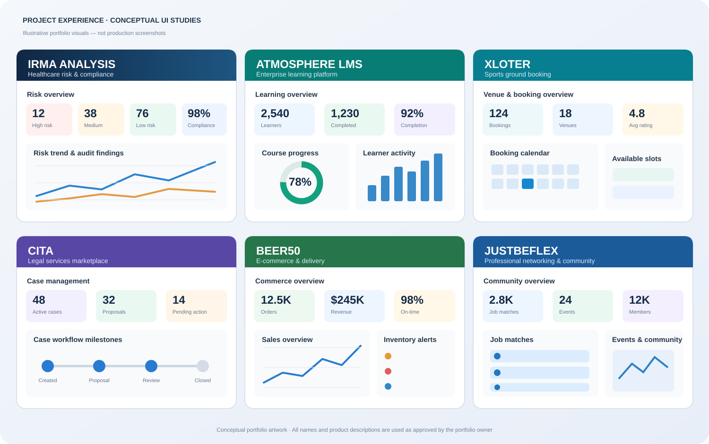

# Jay Jalu

### Senior Software Engineer | Frontend Architecture | React.js · Angular · TypeScript · Node.js

I’m a software engineer with **8+ years of experience** building enterprise web applications across frontend and full-stack development. My core strength is frontend engineering with **Angular, React.js, TypeScript, and JavaScript**, supported by hands-on experience in Node.js, Express, PHP/Laravel, databases, and delivery automation.

I focus on turning product requirements into maintainable applications through modular architecture, reusable UI components, predictable state management, API integration, performance improvements, and reliable release workflows.

[LinkedIn](https://www.linkedin.com/in/jay-jalu/) · [GitHub](https://github.com/jayjalu)

---

## Engineering focus

- **Frontend:** Angular, React.js, Next.js, TypeScript, JavaScript (ES6+), RxJS, NgRx, HTML5, CSS3/SCSS, Tailwind CSS
- **Architecture:** Micro Frontends, Webpack Module Federation, reusable component design, RESTful API integration
- **Backend:** Node.js, Express.js, PHP, Laravel, REST APIs, WebSockets, JWT/OAuth concepts
- **Databases:** MongoDB, MySQL, PostgreSQL
- **DevOps & delivery:** Docker, GitHub Actions, GitLab CI, Git, CI/CD workflows
- **AI-assisted development:** Ollama, prompt engineering, Claude Code, GitHub Copilot

## Selected project experience

The projects below summarize product work described in my professional experience. They are **portfolio case studies, not public source-code repositories**. The previews are conceptual representations created for this portfolio and are not screenshots of production systems.

| Project | Product area | Technologies |
|---|---|---|
| [IRMA Analysis](projects/irma-analysis.md) | Healthcare risk assessment & compliance | Angular, Node.js, REST APIs |
| [Atmosphere LMS](projects/atmosphere-lms.md) | Enterprise learning management | Angular, Node.js, Docker |
| [Xloter](projects/xloter.md) | Sports venue booking | Next.js, React Native, Node.js |
| [CITA](projects/cita.md) | Legal services marketplace | Angular, Node.js, Express |
| [Beer50](projects/beer50.md) | E-commerce & delivery | Angular, Node.js, MongoDB |
| [JustBeFlex](projects/justbeflex.md) | Professional networking & community | Angular, Node.js, MongoDB |

### Conceptual project previews

## Professional experience

- **Matrixbrains Pvt Ltd** — Senior Software Engineer | May 2024 – Present
- **Crenspire Technologies** — Software Engineer | July 2020 – April 2024
- **Solution Analysts** — Software Engineer | April 2019 – June 2020
- **Scalable Labs** — Web Developer (Backend & Full-Stack) | February 2018 – March 2019

## Engineering practices

- Building modular frontend applications and shared UI patterns.
- Managing complex application state with NgRx and RxJS.
- Integrating frontend applications with REST APIs and real-time workflows.
- Containerizing services and supporting automated CI/CD pipelines.
- Applying AI-assisted workflows to accelerate routine engineering tasks and support code quality.

## Contact

I’m interested in senior frontend and full-stack engineering opportunities involving modern web applications, frontend architecture, and product-focused development.

- LinkedIn: [linkedin.com/in/jay-jalu](https://www.linkedin.com/in/jay-jalu/)
- GitHub: [github.com/jayjalu](https://github.com/jayjalu)

---

*Project descriptions are based on my stated professional contributions. Company-owned source code, credentials, customer information, and confidential implementation details are intentionally not included.*
